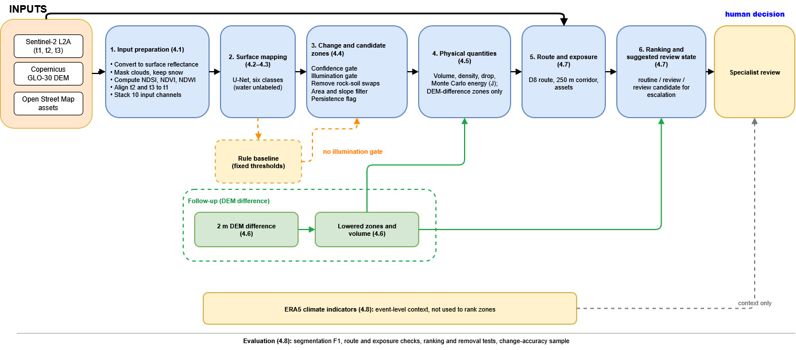
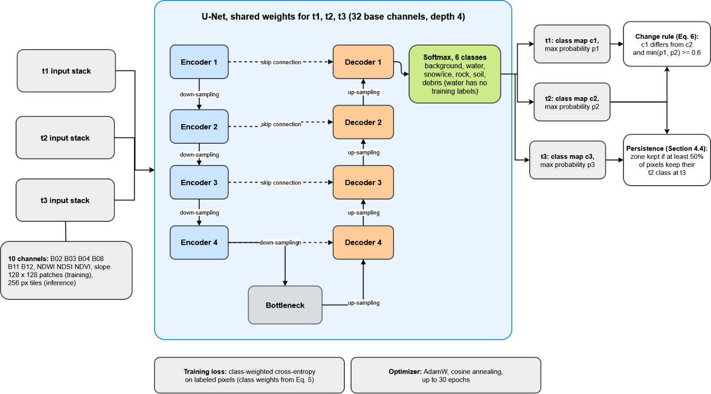
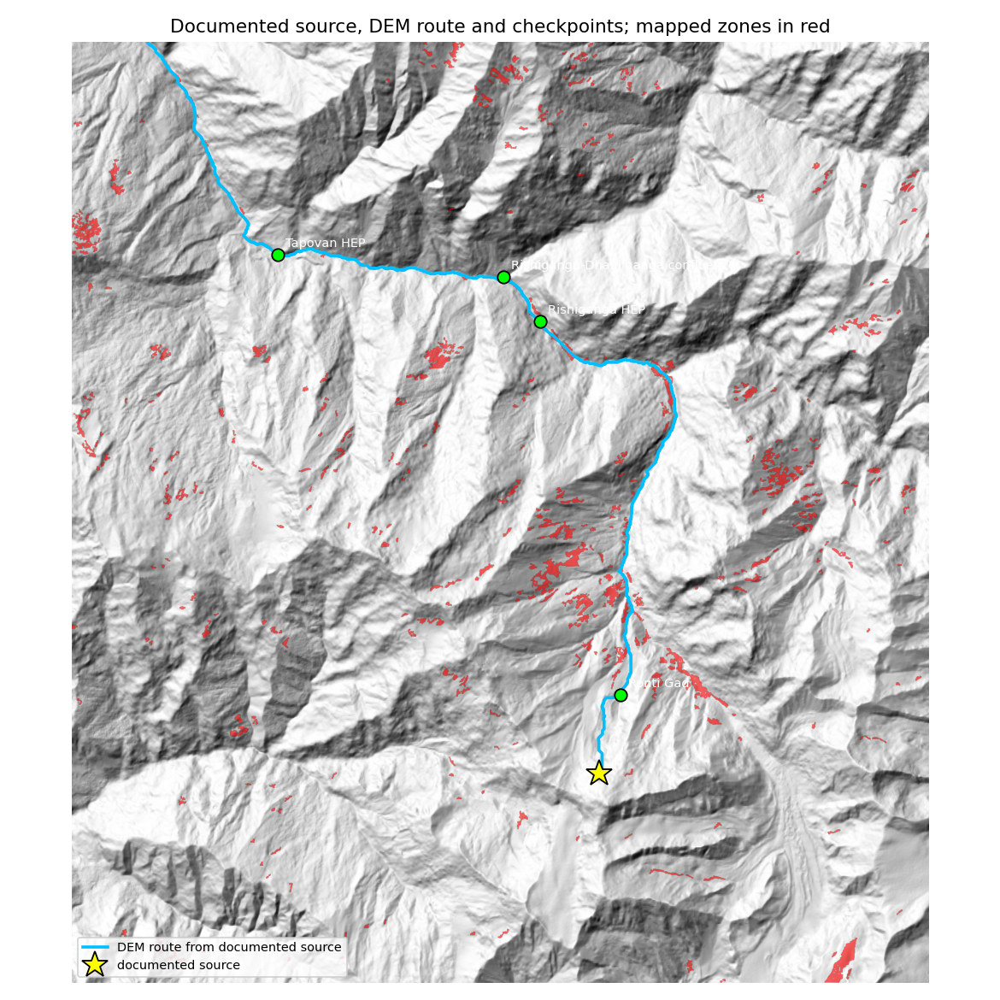

# Mountain Hazard Screening (`mhs`)

Code for the paper **[Deep Learning for Satellite-Based Mountain Hazard Screening: A Retrospective Failure Analysis on the 2021 Chamoli Rock-Ice Avalanche](docs/Deep_Learning_Mountain_Hazard_Screening_Chamoli_2021.docx)** (Snigdhajyoti Rakshit, VIT Bhopal University).
It implements the earlier concept paper *Physics-Guided Mapping of Mountain Hazard Source Zones from Multi-Temporal Satellite Imagery* ([earlier version](https://github.com/Snigdho2005/mountain-hazard-screening/blob/f39808c2579c62450b1c3fc21cc2caf4e334f129/docs/concept_paper.docx)) and runs its minimum viable pipeline end to end:



```
Sentinel-2 (2-3 dates) + DEM
  → input preparation      cloud/shadow masks, common grid, residual co-registration, slope
  → surface mapping        one U-Net, six classes (background, water, snow_ice, rock, soil, debris)
  → change mapping         class-transition map, probability gate, index differences as evidence
  → source zones           connected components, area + slope rules, persistence from t3
  → physical screening     changed volume (DEM difference) and available-volume energy intervals
  → pathway + exposure     D8 route, valley reference point, corridor, assets along it
  → review state           software suggestion only; escalation needs a named specialist
  → archive                maps, GeoJSON, CSV, report, manifest with input hashes and seeds
```

A rule-based baseline (spectral-index classes + change-vector differencing) runs alongside on the same grid and the same rules.



Editable sources of both diagrams (open in [diagrams.net](https://app.diagrams.net)): [`pipeline_overview.drawio`](docs/figures/pipeline_overview.drawio), [`unet_architecture.drawio`](docs/figures/unet_architecture.drawio).

## First case study: 2021 Chamoli rock–ice avalanche

Full write-up: **[docs/chamoli_case_study.md](docs/chamoli_case_study.md)**. Outputs: [`results/chamoli_2021/`](results/chamoli_2021/). Reference labels (63 polygons): [`results/chamoli_2021/labels.geojson`](results/chamoli_2021/labels.geojson).

| Test (concept paper §8) | Result |
|---|---|
| Segmentation, held-out east strip | U-Net macro F1 **0.648 ± 0.025** (3 seeds) vs rule baseline 0.519; rock/soil not separable (F1 ≈ 0.3) |
| Physics (§9 calculation) | reproduced: 5.40 × 10¹⁴ J middle case, Monte Carlo 90 % 4.3–6.6 × 10¹⁴ J |
| Pathway from documented source | all 4 downstream points reached in order; 15.6 km vs ~15 km (Rishiganga HEP), 23.5 km vs 26 km (Tapovan HEP) |
| Exposure | all 3 documented damaged sites in the corridor; OpenStreetMap lacks both hydropower plants |
| Source detection / ranking | **not detected**: shadowed north-east face in winter; ranking and removal tests not evaluable |



**Follow-up experiments** (protocol fixed in advance, 2 Nov 2026): source detection, volume and energy from the 2 m DEM difference; change-detection accuracy; rainfall/temperature indicators. Protocol: [docs/followup_protocol.md](docs/followup_protocol.md); results: [docs/followup_results.md](docs/followup_results.md) (elevation change detects the source; framework ranks it in the top 2.5 % but a simple volume ranking does better).

Every output is a screening product for specialist review. Energy is **available gravitational potential energy**. It is not a failure probability, runout, impact force or loss. Routes are **screening corridors**, not runout or inundation boundaries.

## Limitations and drawbacks

The method and its results have clear weaknesses. They are listed here so that nobody reads more into the numbers than they support.

**What the study can and cannot claim**
- **Retrospective, single event.** Settings were developed and tested on the same Chamoli scene, so this is not an independent test. A second event and quiet (non-event) catchments are still needed.
- **Detection after the fact, not prediction.** The pipeline finds ground that has already changed. It does not forecast which slope will fail next.
- **The follow-up experiments are not blind.** They were run after the first test had shown where the method failed.

**Where the method failed**
- **Source missed by optical change detection.** The source face was 73 % in shadow in the winter image before the event, so the U-Net and the rules both missed it. Without a detected source, the ranking and removal tests could not be evaluated on optical zones.
- **Real change suppressed.** On the change-accuracy sample, the U-Net's confidence and illumination gates removed real snow → ground change that the simple rule baseline kept. All four points flagged by the U-Net alone were false alarms.
- **Flawed ranking rule.** Zones are sorted by exposure count before energy. With the DEM-difference zones, the source therefore ranked 14th of 552, while ranking by volume or area alone put it 2nd. The rule was not changed afterwards, because that would mean tuning on the answer.
- **Volume underestimated.** The zone picked by the pre-declared rule gave 0.52 × the published volume. Only a zone chosen after the fact matched it.

**Weak parts of the model**
- **Rock and soil are not separable** (F1 ≈ 0.3).
- **Water has no training labels,** so the six-class model in practice learns five classes.
- **Results vary a lot between runs.** Macro F1 ranged from 0.581 to 0.786 over ten runs, partly from GPU non-determinism. One run alone is not a reliable estimate.
- **The test strip is small,** and all reference labels were drawn by one person.

**Data limits**
- **61 % of change-sample points could not be judged,** mostly because of shadow. All change-accuracy figures apply only to sunlit, unmixed ground, and per-stratum intervals are wide (some strata rest on 2–4 labels).
- **Rarely available input.** Elevation change found the source, but it needs a 2 m DEM difference. Such DEMs are rarely available soon after an event.
- **Incomplete asset data.** OpenStreetMap lacks both hydropower plants that were damaged, so exposure counts are incomplete.
- **Coarse climate data.** The indicators come from one ~31 km ERA5 cell. They are event-level context and cannot rank zones or show cause.

**Scope of the outputs**
- **Energy is available potential energy only.** It is not a failure probability, runout distance, impact force or loss.
- **Routes are screening corridors only.** They come from steepest-descent (D8) routing and are not runout or flood models.

## Quick start

```bash
pip install -e ".[dev]"            # + ".[acquire]" where internet is available
pytest -q                          # 20 tests
mhs demo --out demo_output         # synthetic dev catchment → unseen test catchment, ~2 min on CPU
mhs chamoli                        # paper Section 9 sensitivity calculation
```

On Kaggle or Colab, use `notebooks/kaggle_runner.ipynb`. It covers install, demo, acquisition for Chamoli, weak labels, training, the screening run and archiving.
The notebooks that produced the case-study numbers are `notebooks/kaggle_01_frozen_benchmark.ipynb` and `notebooks/kaggle_02_event_evaluation.ipynb`.

## Commands

| Command | What it does |
|---|---|
| `mhs acquire CONFIG --out DIR` | Least-cloudy Sentinel-2 L2A day per date window (Planetary Computer STAC) plus Copernicus GLO-30 DEM, mosaicked onto one UTM grid |
| `mhs weak-labels CONFIG --out FILE` | Partial labels from high-margin pixels. Soil and debris are left blank on purpose; digitise them by hand |
| `mhs train CONFIG --out DIR` | U-Net on t1 + t2 with a geographic split (train / val / gap / test strips), early stopping, fixed seed |
| `mhs run CONFIG [--model unet.pt]` | Full screening run. Without a model it uses the rule baseline |
| `mhs evaluate RUN --truth FILE [--area full]` | Class-wise IoU/F1, change F1, false-alarm and missed-change rates, U-Net vs baseline |
| `mhs chamoli [--pre --post --polygon --ref-elev]` | Section 9 sensitivity, or recomputation from the Shean et al. DEMs |
| `mhs regrid SRC --like t1.tif --out F` | Resample e.g. a 2 m DEM onto the 10 m image grid |
| `mhs benchmark CONFIG --out DIR --seeds 0 1 2` | U-Net per seed vs baseline on the test strip, mean ± sd |
| `mhs preview CONFIG --out DIR` | RGB / SWIR previews and split strips for labelling in QGIS |
| `mhs rasterize-labels CONFIG --polygons F --out labels.tif` | Polygons with `class` and `date` fields → label raster |
| `mhs label-aid CONFIG --out DIR [--steep]` | Random test-strip points for unbiased labelling |
| `mhs osm-assets CONFIG --out assets.geojson` | Settlements, bridges, hydropower from OpenStreetMap for the whole scene |
| `mhs event-eval CONFIG RUN_DIR` | Ranking, removal tests, pathway and exposure against a documented event |
| `mhs dem-change CONFIG --out DIR` | Lowered zones from a DEM difference: detection, volume, energy, ranking and removal tests |
| `mhs climate CONFIG --out DIR` | ERA5 rainfall and temperature anomalies before the event (Open-Meteo archive) |
| `mhs change-points CONFIG RUN --out DIR` | Blind stratified random points for change/no-change labelling |
| `mhs change-accuracy CONFIG --labels F --key F RUN...` | Area-weighted change precision, recall, F1 with bootstrap intervals |

## Where each part of the concept paper lives

| Concept paper | Module |
|---|---|
| §3 data, Table 1 input preparation | `acquire.py`, `preprocess.py` |
| §4 U-Net surface mapping, §4.2 training record | `model/unet.py`, `model/train.py` |
| Baseline (§4.1, §8) | `baseline.py` |
| Change mapping, alternative explanations (Table 2) | `change.py` |
| §5 source categories, persistence rule | `zones.py` |
| §6 Eqs. 1–3, uncertainty propagation, §6.2 cascade terms | `physics.py` |
| §7 instability record, Table 3 scaling rules | `instability.py` |
| §7.1 stage-one pathway screening | `routing.py` |
| Exposure | `exposure.py` |
| §8 validation measures | `metrics.py` |
| §9 Chamoli | `chamoli.py` |
| §11 review states, Table 4 | `review.py` |
| §12 fixed protocol, archive | `config.py`, `pipeline.py`, `report.py` |

## Rules the code enforces (from the paper)

- Changed volume and available volume are kept separate. Energy is attached only to available volume.
- Available volume needs a declared thickness or depth scenario per source type (`physics.thickness_scenarios_m`). If none is declared, or the scenario range is wider than `max_thickness_ratio`, the zone stays an **area-change record** with no energy.
- Energy is always an interval (Monte Carlo, 90% by default). The output includes the exceedance probability of a screening threshold and the share of spread from volume, density and drop. A zone is marked **inconclusive** if the interval ratio exceeds `max_interval_ratio`.
- A change counts as **persistent** only if a third date or an independent observation confirms it.
- Instability indicators are rescaled to 0–1 only with at least 30 reference values. Missing values stay missing, and no combined index is built.
- The software never assigns `escalated_technical_review`. `apply_specialist_review` requires a named reviewer and a written uncertainty note.
- Every run writes `manifest.json` (input SHA-256 hashes, model hash and metadata, library versions) and `config_used.yaml`.

## Results so far

**Chamoli (published values, `mhs chamoli`).** The corner bounds reproduce the paper: mass 5.28–7.80 × 10¹⁰ kg, energy 3.62–7.65 × 10¹⁴ J, middle case 5.40 × 10¹⁴ J. With uniform input ranges, the Monte Carlo 90% interval is narrower, **4.3–6.6 × 10¹⁴ J** (median 5.37 × 10¹⁴). The **drop accounts for about 64% of the spread**, volume about 23% and density about 13%. Fixing the centroid-to-reference measurement from the original DEMs should therefore come before any refinement of density.

**Synthetic test (`mhs demo`).** The U-Net was trained on one catchment and applied without changes to a second catchment with a different layout. On the unseen catchment:

- Surface map: macro F1 0.996.
- Change detection: F1 0.980 for the U-Net and 0.993 for the baseline.
- All four real changes became zones: lake growth, landslide scar, deposit and glacier thinning.
- The seasonal snow-line shift was marked *not persistent* by the third date and suggested as *routine*.

The synthetic spectra are idealised and match the baseline's rules almost exactly. That is why the baseline wins there. **These numbers test the software, not the method.** Whether the U-Net beats the baseline must be decided on real, geographically separate scenes.

## Known limits of this implementation

- Stage-one routing only: D8 on a filled DEM. Lakes, dams, bridges and DEM artefacts are flagged when the route crosses a filled depression deeper than `fill_depth_flag_m`. Detailed runout modelling is out of scope, as the paper requires.
- Co-registration corrects only a global sub-pixel translation by phase correlation.
- `acquire.py` needs internet access (Kaggle with Internet on, or Colab). It could not be exercised in the development sandbox, so check the first download carefully.
- The Chamoli bbox in `configs/chamoli.yaml` is approximate. Check it against the published source polygon.
