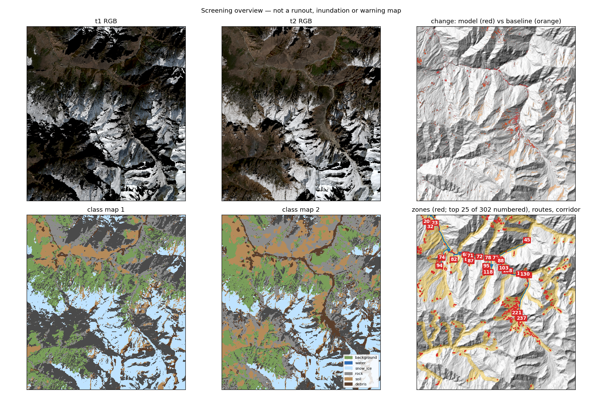
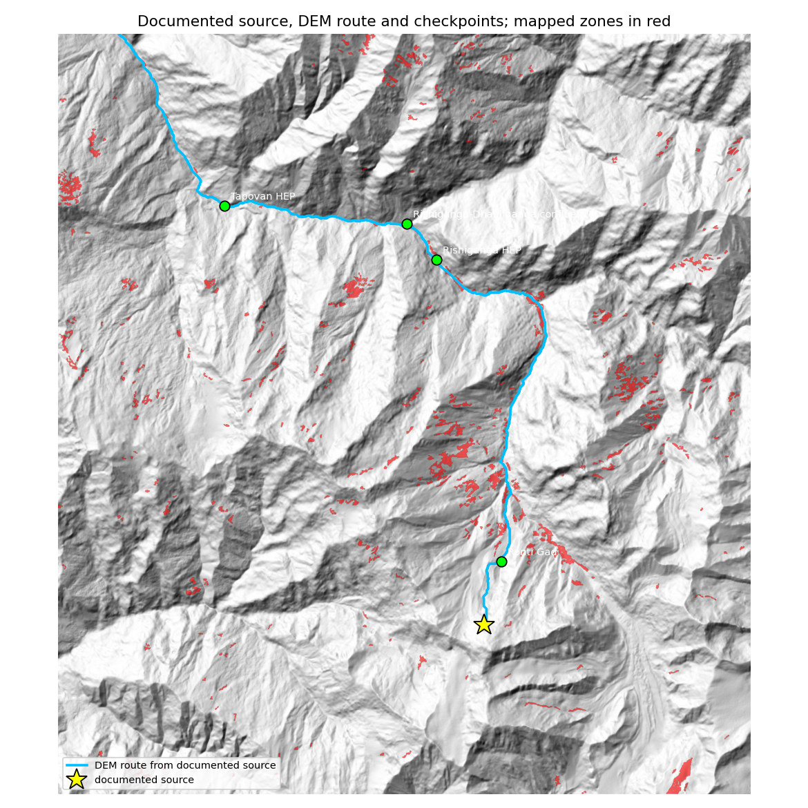

# Physics-Guided Screening of Mountain Hazard Source Zones: A Retrospective Test on the 2021 Chamoli Rock–Ice Avalanche

**Rakshit**, B.Tech Computer Science and Engineering, VIT Bhopal University
*Working draft, November 2026. Code, configuration, labels and all outputs: this repository.*

---

## Abstract

A companion concept paper (*A Food for Thought: Physics-Guided Mapping of Mountain Hazard Source Zones from
Multi-Temporal Satellite Imagery*; [concept_paper.docx](concept_paper.docx)) proposed screening mountain catchments by keeping four kinds of evidence
separate: the potential energy of a source, signs of instability, the downslope route, and exposure along it.
It reported no data, model or results. This document implements the proposed minimum pipeline as open code
and tests it retrospectively on the 7 February 2021 Chamoli (Uttarakhand) rock–ice avalanche, using
Sentinel-2 imagery, the Copernicus GLO-30 DEM and OpenStreetMap, with a protocol fixed before outcomes were
examined.

A six-class U-Net outperformed a rule-based baseline on a geographically held-out strip (macro F1
0.648 ± 0.025 vs 0.519 over three seeds; all seven U-Net runs above the baseline), but did not separate rock
from soil (F1 ≈ 0.3 each). A DEM route traced from the documented source passed all four documented
downstream points in order, within 28–78 m, at along-route distances within 0.6 km (Rishiganga plant) and
2.5 km (Tapovan plant) of published values. All three documented damaged sites lay inside the 250 m screening
corridor, but OpenStreetMap listed neither hydropower plant. The documented source itself was **not
detected**: no mapped change zone lay within 500 m of it in any of four runs. The source is a steep,
north-east-facing face that was largely shadowed in the January image; the illumination gate that suppresses
false change from low winter sun removed much of the signal there. Ranking and component-removal tests were
therefore not evaluable for this event. Route and exposure screening work for this case; source detection
from winter optical imagery is the limiting step.

---

## 1. Introduction

Mountain disasters often begin far above the people they affect: a rock face, hanging glacier, moraine lake
or stored debris becomes unstable and moves down a valley. Satellites cover these areas repeatedly, but
visible change alone says neither how much material could move nor where it would go. The concept paper
proposed a screening framework that:

1. maps surface change between dates with one segmentation model;
2. forms candidate source zones from that change;
3. attaches physical quantities (mass, potential energy) with explicit uncertainty;
4. traces a broad downslope route and records exposure along it; and
5. suggests a review state for specialists, without issuing warnings.

The concept paper set out how such a framework should be validated (its Section 8): segmentation and change
metrics against held-out labels, comparison with a simple baseline, pathway and exposure checks, ranking of
documented sources, and removal tests that drop one component at a time. It also asked that failures be
reported alongside successes (its Section 10).

This document reports the first such test. The aim is not to show that the framework works, but to find out,
on one well-documented event, which parts work and which do not.

---

## 2. Study area and data

### 2.1 Event

On 7 February 2021 about 27 × 10⁶ m³ of rock and glacier ice detached from the steep north face of Ronti Peak
(6,063 m) at about 5,500 m a.s.l., fell about 1,800 m to the Ronti Gad valley floor and became a highly mobile
debris flow down the Rishiganga and Dhauliganga. It destroyed the Rishiganga hydropower project about 15 km
downstream and badly damaged the Tapovan Vishnugad project about 26 km downstream; more than 200 people were
killed or missing (Shugar et al., 2021).

### 2.2 Scene and inputs

| Item | Value |
|---|---|
| Area | lon 79.58–79.80 E, lat 30.33–30.54 N (approx. 21 × 23 km) |
| Grid | UTM 44N (EPSG:32644), 10 m |
| Optical | Sentinel-2 L2A, bands B02 B03 B04 B08 B11 B12; least-cloudy day per window |
| t1 (pre-event) | 2021-01-16 (window 15 Jan – 6 Feb 2021) |
| t2 (post-event) | 2021-02-25 (window 8 Feb – 10 Mar 2021) |
| t3 (persistence) | 2022-03-12 (window 15 Jan – 15 Mar 2022) |
| DEM | Copernicus GLO-30, bilinear to the 10 m grid |
| Assets | OpenStreetMap via Overpass, 1 Nov 2026: 45 features (37 settlements, 8 bridges, 0 hydropower) |
| Reference event | GEER reconnaissance report (coordinates); Shugar et al. 2021 (distances) |

Usable pixels on both t1 and t2 after masking: 317.8 km² (63 % of the scene). The t2 residual offset of
0.52 px was corrected.

The DEM was read from Microsoft Planetary Computer for the main benchmark. On 1 November 2026 that endpoint
returned HTTP 404, so the event evaluation used the identical GLO-30 tile from the AWS open-data bucket
(Section 5.2 shows the change did not alter the benchmark mean).

### 2.3 Reference labels

Labels were digitised in QGIS on SWIR false-colour (B12-B08-B04) and true-colour previews at 1:5,000 or larger,
with a `class` field (six classes) and a `date` field (`t1`, `t2` or `both`). Polygons were drawn small and
inside uniform surfaces. To reduce selection bias in the test strip, rock and soil test labels were placed at
**randomly generated points** (30 on any bare ground, then 20 restricted to steep, unshadowed bare ground),
each labelled rock, soil or skipped by eye; 26 of the 50 were skipped as mixed, shadowed or snow-covered.

Final set: 63 polygons. Labelled pixels by strip (t1 + t2):

| strip | background | water | snow_ice | rock | soil | debris |
|---|---|---|---|---|---|---|
| train | 9,126 | 0 | 27,573 | 13,910 | 38,311 | 2,077 |
| validation | 10,208 | 0 | 2,042 | 0 | 5,698 | 0 |
| test | 1,225 | 0 | 11,322 | 1,535 | 5,285 | 0 |

---

## 3. Methods

All thresholds, ranges and rules are declared in `configs/chamoli.yaml` (overriding `mhs/config.py`) and
archived with each run, together with input hashes, software versions and seeds.

### 3.1 Input preparation (`acquire.py`, `preprocess.py`)

- **Snow-aware cloud mask.** Sentinel-2 SCL cloud classes are masked, except where NDSI > 0.4 and SWIR1 < 0.2
  (snow misclassified as cloud). Cloud shadow is masked only within 3 km of detected cloud; cloud edges are
  buffered by 2 pixels.
- Reflectance from DN with processing-baseline offset; residual co-registration of t2 and t3 to t1
  (correct above 0.5 px, reject above 2 px).
- Features: six bands, NDWI, NDSI, NDVI and DEM slope.

### 3.2 Geographic split

The scene is cut into vertical strips of 64 pixels. The eastmost 25 % is the **test strip**, separated by one
unused gap strip; 15 % at the **west** edge is validation; the rest is training. Validation was placed on the
west edge because, on the east side, it covered the 2021 flow channel and removed all debris examples from
training. Training patches are drawn only from training columns.

### 3.3 Surface mapping (`model/unet.py`, `model/train.py`)

One U-Net (base 32 channels, depth 4) maps six classes on t1, t2 and t3 with the same weights. Training:
128 × 128 patches, batch 16, 800 patches per epoch, AdamW (lr 1e-3, weight decay 1e-4), cosine schedule, up to
30 epochs, cross-entropy weighted by inverse square-root class frequency, random 90° rotations and flips.
The checkpoint with the lowest **validation cross-entropy** is kept (patience 6). The benchmark trains three
seeds and reports mean ± sd.

### 3.4 Rule baseline (`baseline.py`)

Spectral-index rules give the same six classes (water additionally requires slope < 12°); baseline change is
a class change confirmed by change-vector differencing. It runs on the same grid, split and zone rules.

### 3.5 Change and source zones (`change.py`, `illumination.py`, `zones.py`)

- Class maps of t1 and t2 are compared; a pixel counts as changed only if the class probability is ≥ 0.6 on
  both dates.
- **Illumination gate.** Sun position is taken from image metadata. A pixel is "shadowed" if its cosine of
  incidence is below 0.15 or it is in cast shadow. Changed pixels whose shadow state differs between dates are
  removed.
- Rock↔soil swaps are not counted as change (declared after the first runs showed many such swaps; Section 6).
- Changed pixels are cleaned by a 1-pixel opening, joined by 8-connectivity, and kept if ≥ 5,000 m². Snow/ice and
  rock/soil sources need a median slope ≥ 15°.
- **Persistence**: a zone is persistent if ≥ 50 % of it keeps the t2 class at t3. Snow transitions can be
  confirmed only by a t3 in the same season as t2 (here 15 days apart in day-of-year).

### 3.6 Physical quantities (`physics.py`, `chamoli.py`)

Mass and potential energy (concept paper Eqs. 1–3) are computed by Monte Carlo (20,000 samples, 90 %
intervals) from declared ranges of volume, density and drop. Available volume requires an independently
supported thickness range per source type. **None was declared for this case**, so every zone remains an
area-change record without an energy value. For the ranking evaluation only, an energy **index**
ρ·g·A·Δh (J per metre of source thickness) is used: it orders zones as energy would if all had the same
thickness, and is never reported as energy.

### 3.7 Route and exposure (`routing.py`, `exposure.py`, `assets_osm.py`)

Depressions in the DEM are filled, a D8 flow direction is derived, and each zone is traced from its outlet for
up to 40 km. The reference elevation for the drop is the first valley-floor cell (contributing area ≥ 2 km²,
slope ≤ 8°). A corridor of ±250 m around the route is the screening area. Routes crossing a filled depression
deeper than 30 m are flagged. Exposure lists inventory assets inside the corridor with along-route distance.
The asset inventory is taken from OpenStreetMap for the **whole scene**, not only damaged sites, so the
exposure test is not circular. Roads are excluded because as lines they cross almost every corridor.

### 3.8 Review states (`review.py`)

The software suggests `routine`, `review` or `review_candidate_for_escalation`; escalation needs a named
specialist and a written uncertainty note. No state authorises warnings or closures.

### 3.9 Evaluation protocol

**Segmentation** (`mhs benchmark`): per-class F1, macro F1 and accuracy on the test strip, U-Net (three seeds)
vs baseline.

**Event evaluation** (`mhs event-eval`). The reference event was written into the config from published
sources **before** the test was run:

| point | lon, lat | published along-flow distance |
|---|---|---|
| Source: detachment, north face of Ronti Peak | 79.716431, 30.376403 | – |
| Ronti Gad | 79.721864, 30.394242 | – |
| Rishiganga HEP | 79.699903, 30.478344 | ~15 km |
| Rishiganga–Dhauliganga confluence | 79.690131, 30.488206 | – |
| Tapovan HEP | 79.631253, 30.492458 | 26 km |
| Damaged: Rishiganga HEP, Raini bridge (79.694322, 30.485542), Tapovan HEP | | |

1. *Source diagnostics*: within 1 km of the source, the usable fraction, shadow on each date, classes and
   changed pixels.
2. *Ranking*: best rank of any zone within 500 m, 1 km and 2 km of the source, compared with the random
   expectation (N + 1)/(m + 1) for m matched zones among N.
3. *Removal tests*: the same ranking without energy, instability, exposure, or route (removing the route also
   removes corridor exposure), plus two simple baselines (largest area first; most confident change first).
4. *Pathway*: a route traced from the documented source; a checkpoint is reached if the route passes within
   250 m; along-route distances are compared with published ones.
5. *Exposure*: inventory assets in that route's corridor, and whether the documented damaged sites lie in it.

The event evaluation was run on three U-Net seeds (repeat run, Section 5.2) and on the rule baseline.

---

## 4. Results

### 4.1 Physics: reproduction of the concept-paper calculation

With the concept paper's published ranges (volume 24–30 × 10⁶ m³, density 2,200–2,600 kg m⁻³, drop 700–1,000 m):

| | low | middle | high |
|---|---|---|---|
| Mass (kg), corner values | 5.28 × 10¹⁰ | 6.48 × 10¹⁰ | 7.80 × 10¹⁰ |
| Energy (J), corner values | 3.62 × 10¹⁴ | 5.40 × 10¹⁴ | 7.65 × 10¹⁴ |
| Energy (J), Monte Carlo 90 % interval | 4.30 × 10¹⁴ | 5.37 × 10¹⁴ (median) | 6.61 × 10¹⁴ |

Both match the concept paper. The drop contributes 64 % of the spread, volume 23 %, density 13 %. These are
sensitivity ranges for the published inputs, not measured event-energy bounds.

### 4.2 Segmentation

Held-out east test strip, frozen run (full tables in `results/chamoli_2021/benchmark.md`):

| class | test pixels | U-Net F1 (mean ± sd, 3 seeds) | baseline F1 |
|---|---|---|---|
| background | 1,225 | **0.982 ± 0.018** | 0.713 |
| snow_ice | 11,322 | 0.997 ± 0.005 | 1.000 |
| rock | 1,535 | 0.301 ± 0.032 | **0.354** |
| soil | 5,285 | **0.311 ± 0.097** | 0.009 |
| **macro F1** | | **0.648 ± 0.025** | 0.519 |
| overall accuracy | | 0.740 ± 0.020 | 0.695 |

- The U-Net beats the baseline overall; the gain comes from soil and background.
- Rock and soil are confused with each other (F1 ≈ 0.3 each); the baseline is no worse on rock.
- Water and debris have no test labels and are not evaluable on this split.

### 4.3 Change mapping

Frozen U-Net run (seed 0): 302 candidate zones (24 removed by slope rules). The illumination gate removed
9.15 km² of class change and the rock↔soil rule 3.17 km². Largest transitions: snow_ice → debris 2.86 km²,
background → soil 1.93 km², snow_ice → soil 1.67 km², soil → debris 0.99 km², snow_ice → rock 0.96 km²,
rock → debris 0.68 km².

Zone counts vary strongly between models trained with different seeds (repeat run: 371, 126 and 131 zones;
rule baseline 434), even though test-strip F1 varies less. In the seed-0 repeat run, the highest-ranked zones
are mostly rock → debris and background → debris zones with six to nine exposed assets in their corridors,
consistent with fresh 2021 deposits along the Rishiganga and Dhauliganga (an observation, not a tested result).



### 4.4 Event evaluation

**Source diagnostics** (within 1 km of the documented source; identical inputs in all runs):
DEM elevation at the point 5,289 m; slope 39°; aspect 44° (north-east). Usable on both dates 86 %. Shadowed:
73 % at t1, 47 % at t2, 47 % on both dates. Thus 26 % of the area changed shadow state between dates, which
the illumination gate removes, and a further 47 % was shadowed on both dates.

| run | changed pixels within 1 km (before zone rules) | pixels in zones | zones within 500 m / 1 km / 2 km |
|---|---|---|---|
| U-Net seed 0 | 112 | 0 | 0 / 0 / 1 |
| U-Net seed 1 | 0 | 0 | 0 / 0 / 0 |
| U-Net seed 2 | 274 | 199 | 0 / 1 / 1 |
| Rule baseline | 763 | 150 | 0 / 1 / 4 |

**No zone lay within 500 m of the source in any run.** The zones found 1–2 km away are debris → snow_ice or
soil → snow_ice transitions (snow *gained*), whereas a detachment should appear as loss of snow/ice and
exposure of rock. These zones are therefore not detections of the source, and the ranking and removal tests
(full tables in `results/chamoli_2021/event_eval/`) **cannot be interpreted as evidence for or against the
framework**. For completeness: the nearest zone ranked 6th of 131 (seed 2) and 12th of 434 (baseline) under
the full ranking, against random expectations of 66 and 87–218.

**Pathway.** The route from the documented source (identical for all runs, as it depends only on the DEM):

| checkpoint | closest approach | reached | along route | published |
|---|---|---|---|---|
| Ronti Gad | 78 m | yes | 2.4 km | – |
| Rishiganga HEP | 28 m | yes | **15.6 km** | ~15 km |
| Rishiganga–Dhauliganga confluence | 51 m | yes | 17.1 km | – |
| Tapovan HEP | 28 m | yes | **23.5 km** | 26 km |

All four points were reached in the correct order. The route crosses a 34 m filled depression in the gorge
(flagged as a likely DEM artefact). The 2.5 km shortfall at Tapovan (about 10 %) is consistent with a single
D8 flow line cutting meanders that the flow followed.



**Exposure.** Six OpenStreetMap assets lay in the corridor: Reni Bridge (tagged "Destroyed", 16.6 km), Reni
village (16.9 km), a Joshimath–Malari road bridge (18.0 km), an unnamed bridge (24.3 km), Garghaniya
(25.0 km) and an unnamed bridge (25.2 km). All three documented damaged sites lie inside the corridor (3/3).
The inventory matched only one of them (Raini bridge): **OpenStreetMap contained no hydropower features in the
scene**, so the two most heavily damaged structures were absent from the exposure list.

### 4.5 Summary against the concept paper's validation plan

| Section 8 test | Outcome |
|---|---|
| Segmentation vs baseline | U-Net better overall (0.648 vs 0.519); rock/soil not separable |
| Change detection vs held-out change labels | not measurable: no change reference labels |
| Energy estimation | published-value calculation reproduced; no event volume measured here |
| Pathway | correct drainage connection, all checkpoints in order; distances within 0.6 and 2.5 km |
| Exposure | damaged sites in corridor 3/3; public inventory incomplete (1/3) |
| Ranking of the documented source | not evaluable: source not detected |
| Removal tests | not interpretable without a detected source |

---

## 5. Reproducibility and robustness

### 5.1 Recorded failures and the changes they caused

Each change below was made **before** the final benchmark and event test and is recorded in the config:

| observation | change |
|---|---|
| Default cloud mask removed snow (t1 only 60 % valid) | snow-aware mask (Section 3.1) |
| t1 from February 2020: ~1,400 zones, mostly inter-annual snow differences | t1 moved to the same winter (Jan 2021) |
| Low winter sun produced change on slopes lit on one date only | illumination gate |
| An October t3 "confirmed" seasonal snowmelt as persistent | winter t3 and season-aware persistence |
| Validation strip on the east side contained all debris labels | validation moved to the west edge |
| Validation macro F1 unstable with 2–3 classes | selection on validation cross-entropy |
| Many rock↔soil swaps (324 zones) | rock↔soil transitions ignored (210 zones) |
| Test strip lacked rock/soil labels | random-point labelling round, then labels frozen |

After the labels were frozen, no labels, thresholds or settings were changed. In particular, the illumination
gate was **not** relaxed after the source was found to be missed.

### 5.2 Run-to-run variation

Training is not bit-reproducible on the GPU used (Tesla T4): the same seed gave macro F1 0.747 and then 0.617.
A repeat 3-seed benchmark after the DEM source change gave 0.643 ± 0.078 (frozen run 0.648 ± 0.025). Means
agree; single runs vary widely (soil F1 0.015–0.755). All seven U-Net runs exceeded the baseline.

### 5.3 How to reproduce

```bash
pip install -e ".[acquire,dev]"
pytest -q
mhs acquire configs/chamoli.yaml --out data/chamoli
mhs rasterize-labels configs/chamoli.yaml --polygons results/chamoli_2021/labels.geojson --out data/chamoli/labels.tif
mhs benchmark configs/chamoli.yaml --out models/bench --seeds 0 1 2
mhs osm-assets configs/chamoli.yaml --out data/chamoli/assets.geojson
mhs run configs/chamoli.yaml --model models/bench/seed_0/unet.pt --out runs/chamoli_unet_s0
mhs run configs/chamoli.yaml --out runs/chamoli_rules
mhs event-eval configs/chamoli.yaml runs/chamoli_unet_s0 --out runs/event_eval_unet_s0
mhs chamoli
```

The Kaggle notebooks that produced the reported numbers are in `notebooks/`.

---

## 6. Discussion

**What works.** Given a source location, the DEM route and corridor reproduced the real flow path through
four documented points and enclosed every documented damaged structure. The physics layer reproduces the
concept-paper calculation and carries uncertainty through rather than attaching it at the end. The U-Net is a
consistent improvement over simple spectral rules for this scene.

**What does not.** The screening chain would not have placed Ronti Peak on a review list from these images.
The source is a steep north-east face in mid-winter: mostly shadowed in January and partly lit in February.
The illumination gate was introduced because low sun produced large false change elsewhere; at this source it
removes the pixels where change would appear. Fewer false alarms were bought at the price of missing a
shadowed source. This trade-off is likely general for winter optical screening of north-facing faces, which is
where many Himalayan rock–ice sources lie.

**Rock vs soil.** At 10 m in winter imagery, rock and soil were not separable by either method. The decision to
ignore rock↔soil swaps in change mapping is therefore justified, but it also means a rock-slope failure that
exposes fresh rock on a soil-like surface would not register.

**Exposure data.** A public inventory missed the two largest exposed structures. Exposure screening is only as
complete as the asset data, and hydropower in particular should come from an authoritative register.

**Energy.** Without independently supported thickness ranges, no zone received an available-energy estimate.
This is the intended behaviour of the framework (no unsupported numbers), but it means the energy component was
represented only by an area × drop index in the ranking tests.

## 7. Limitations

- One event, one scene, one geographic split; no non-event catchment.
- No change reference labels, so change-detection F1 and false-alarm rates were not measured.
- Water and debris had no test-strip labels; the rock test set is small (1,535 pixels).
- The validation strip contains no rock or debris, so model selection cannot favour those classes.
- GPU training is not bit-reproducible; results are reported as means over seeds.
- Slope, aspect and shadows come from the 30 m GLO-30 DEM resampled to 10 m, so narrow ridges and gullies are smoothed.
- OpenStreetMap was accessed in 2026, five years after the event.
- Routes are single D8 lines with a fixed corridor: screening connections, not runout or inundation models.

## 8. Conclusions and next steps

On the 2021 Chamoli event, the route and exposure components of the framework reproduced what happened, the
physics layer reproduced the published calculation, and the U-Net improved on simple rules. The documented
source was not detected from winter Sentinel-2 imagery, because the face was largely in shadow and the
safeguard against shadow-induced false change removed its signal. The framework's ranking claim therefore
remains untested.

Next steps, in order of expected value:

1. Add a source-detection input that is insensitive to shadow: Sentinel-1 SAR backscatter/coherence change,
   or the Shean et al. (2021) pre/post DEM difference (`mhs regrid` and `mhs chamoli --pre --post` already
   support the latter).
2. Replace the binary illumination gate with a graded confidence penalty, tested on a separate event.
3. Use an authoritative hydropower/infrastructure register for exposure.
4. Test on a second event and on non-event catchments, with change reference labels, to measure false-alarm
   rates and ranking.

---

## Data and code availability

Code, configuration, evaluation outputs and Kaggle notebooks: this repository. Concept paper:
`docs/concept_paper.docx`. Reference labels (63 polygons, fields `class` and `date`):
`results/chamoli_2021/labels.geojson`. Sentinel-2 L2A and
Copernicus GLO-30 are open data (ESA / Copernicus); OpenStreetMap data © OpenStreetMap contributors (ODbL).

## References

- GEER (Geotechnical Extreme Events Reconnaissance) Association (2021). *Site Visit and Drone Based
  Reconnaissance Study of the Severely Affected Areas, Chamoli, Uttarakhand.*
  https://geerassociation.org/components/com_geer_reports/geerfiles/Chamoli_Report.pdf
- Ronneberger, O., Fischer, P. and Brox, T. (2015). U-Net: Convolutional Networks for Biomedical Image
  Segmentation. *MICCAI*, LNCS 9351, 234–241.
- Shean, D. et al. (2021). Pre- and post-event DEMs of the 2021 Chamoli event. Zenodo,
  doi:10.5281/zenodo.4558692.
- Shugar, D. H. et al. (2021). A massive rock and ice avalanche caused the 2021 disaster at Chamoli, Indian
  Himalaya. *Science* 373(6552), 300–306. doi:10.1126/science.abh4455.
- European Space Agency. Copernicus Sentinel-2 Level-2A and Copernicus DEM GLO-30.
- OpenStreetMap contributors. https://www.openstreetmap.org
